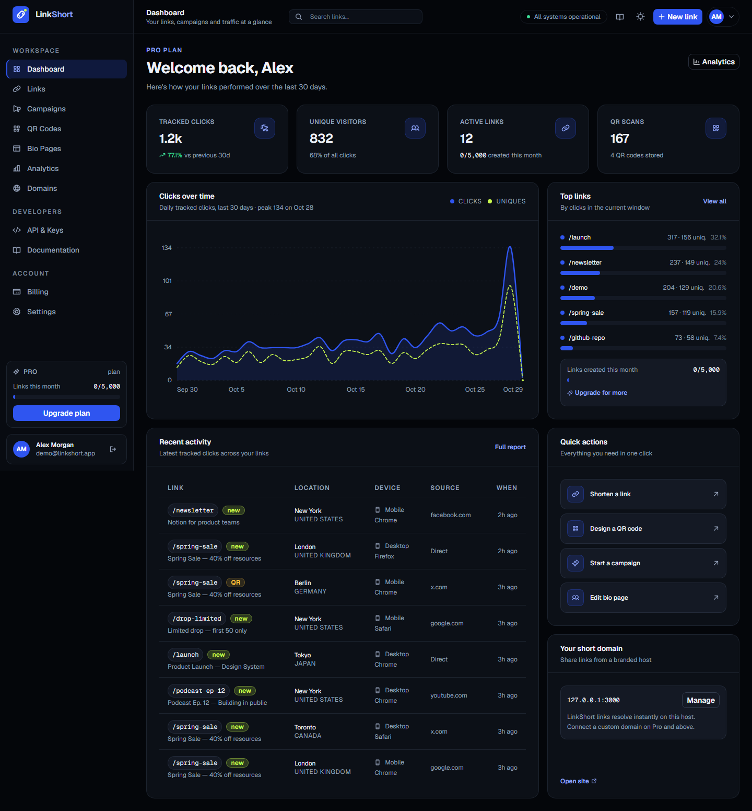

# LinkShort

A self-hosted link shortener with branded short links, QR codes, campaigns, bio pages and click analytics. One Next.js app, one SQLite file, no external services.



- [Highlights](#highlights)
- [Stack](#stack)
- [Quickstart](#quickstart)
- [Configuration](#configuration)
- [Plans](#plans)
- [How a short link is served](#how-a-short-link-is-served)
- [REST API](#rest-api)
- [Routes](#routes)
- [Data model](#data-model)
- [Design system](#design-system)
- [Project structure](#project-structure)
- [Deployment](#deployment)
- [Status and limits](#status-and-limits)

## Highlights

- **Short links** — custom aliases, expiry dates, click caps, password protection, pause/resume, UTM parameters, A/B variants and bulk actions.
- **Click analytics** — 7/30/90/365 day windows, country/city/device/browser/OS/referrer breakdowns, unique visitors, bot filtering, CSV export of raw rows.
- **QR codes** — foreground/background colours, quiet-zone margin, error-correction level, centre label, click attribution per code, SVG export.
- **Campaigns** — group links under a colour-coded campaign, compare performance per channel.
- **Bio pages** — themed public pages at `/p/[slug]` with social, heading and text blocks; every tap is tracked as a click.
- **Custom domains** — add branded domains and verify them with a DNS TXT record.
- **Plans and billing** — Free/Basic/Pro/Growth quotas enforced in the API layer, invoice history, auto-renew toggle.
- **Public REST API** — bearer-key endpoints under `/api/v1`; link creation is limited to 240 requests per minute per user.
- **Two themes** — midnight black by default, light theme available, both driven by one set of CSS tokens.

## Stack

| Layer | Choice |
| --- | --- |
| Framework | Next.js 15 (App Router, React 19, server components) |
| Language | TypeScript, strict mode |
| Styling | Tailwind CSS v4 with `@theme inline` tokens in `app/globals.css` |
| Data | SQLite through the built-in `node:sqlite` module |
| Icons | Phosphor Icons |
| QR rendering | `qrcode` (SVG output) |
| Auth | HMAC-SHA256 signed session cookie, scrypt password hashes |
| Build | `next build` — no extra bundler or transpiler step |

## Quickstart

Requires **Node.js 22.5+** (24 recommended); the app relies on `node:sqlite`, which ships with Node. No database server, no Docker, no API keys.

```bash
npm install
npm run dev
```

Open http://localhost:3000. On first request the app creates and seeds `data/linkshort.db` with a demo workspace. Sign in with:

```
email:    demo@linkshort.app
password: demo1234
```

The seed includes 13 links, four campaigns, four QR codes, a bio page and ~30 days of click history, so the dashboard and analytics screens have something to show immediately. Delete `data/` to reseed from scratch.

## Configuration

Every variable is optional for local development. Copy `.env.example` to `.env.local` to override.

| Variable | Default | Purpose |
| --- | --- | --- |
| `APP_SECRET` | dev placeholder | HMAC key for session cookies and click signatures. **Set this in production** — changing it invalidates sessions and password-unlock cookies. |
| `APP_URL` | request origin | Public base URL used for short links, QR payloads and email links. Set it when running behind a proxy. |
| `DATABASE_PATH` | `data/linkshort.db` | Absolute path to the SQLite file. |
| `COOKIE_SECURE` | unset | Set to `1` to mark the session cookie `Secure`. Do this behind HTTPS. |

Generate a secret with:

```bash
node -e "console.log(require('crypto').randomBytes(32).toString('hex'))"
```

## Plans

Quotas are enforced when links, QR codes, campaigns, bio pages and domains are created. The plan's analytics window caps the ranges offered in the dashboard.

| Plan | Price | Links / month | QR codes | Campaigns | Bio pages | Domains | Analytics window |
| --- | --- | --- | --- | --- | --- | --- | --- |
| Free | $0 | 100 | 5 | 3 | 1 | 0 | 7 days |
| Basic | $5 | 1,000 | 50 | 20 | 5 | 1 | 30 days |
| Pro | $13 | 5,000 | 100 | 50 | 15 | 3 | 90 days |
| Growth | $41 | 15,000 | 250 | 150 | 30 | 10 | 365 days |

Exceeding a quota returns HTTP `402` with a message naming the limit and the plan.

## How a short link is served

`GET /<code>` is handled by a single route handler (`app/[code]/route.ts`) and returns HTML on the public domain, so errors are styled pages rather than bare JSON:

1. **Lookup** — the code is validated against `[A-Za-z0-9_-]{1,64}`, then resolved from the `links` table. Unknown codes get a 404 page.
2. **Status** — paused links, expired links and links that already hit their click cap return `410` with an explanation page.
3. **Password** — links with a password hash render a form (`401`) unless the visitor already holds a signed unlock cookie for that code.
4. **Destination** — an A/B variant is picked against the configured weight, then UTM parameters from the link are applied to the target URL.
5. **Capacity** — the click counter is incremented in a single conditional `UPDATE`, so concurrent requests cannot exceed `max_clicks`.
6. **Tracking** — a click row is written with country, city, device, OS, browser, referrer host, UTM values, variant and QR attribution.
7. **Redirect** — `302` with `cache-control: no-store`. Links carrying retargeting pixels render a small HTML interstitial instead, so the pixel fires before navigation.

Tracking details worth knowing:

- **Unique visitors** are first-seen-per-link, computed from a truncated HMAC of the client IP — raw IPs are never stored.
- **Bot traffic** is flagged (`is_bot`) from the user agent and excluded from visitor counts.
- **QR scans** are attributed when the redirect carries `?qr=<qrcode id>` (generated QR payloads do) and increment the code's scan counter.
- Click rows are written before the redirect is returned, so counts are consistent immediately.

## REST API

The public API uses the account API key (visible and rotatable on `/app/api`), not the session cookie.

```bash
curl -X POST http://localhost:3000/api/v1/shorten \
  -H "Authorization: Bearer $LINKSORT_KEY" \
  -H "Content-Type: application/json" \
  -d '{"url":"https://example.com/launch","alias":"launch","title":"Launch","tags":["launch"]}'
```

| Method | Path | Purpose |
| --- | --- | --- |
| `POST` | `/api/v1/shorten` | Create a link. Accepts `url`, `alias`, `title`, `campaignId`, `tags`, `password`, `expiresAt` (ISO date or epoch ms), `maxClicks`, `utm*`, `variantB`, `abWeight`. |
| `GET` | `/api/v1/links` | List links with `q`, `status`, `sort`, `page`, `size`. |
| `POST` | `/api/v1/links` | Create a link (same body as `/shorten`). |
| `GET` | `/api/v1/links/[code]` | Fetch one link by code. |

Rate limit: **240 link creations per minute per user**, over the limit returns `429`. Errors are always JSON in the shape `{ "error": "message" }` with a matching status code (`400` validation, `401` auth, `402` quota, `404` missing, `429` rate limit). `POST /api/v1/shorten` and `GET /api/v1/links/[code]` return the link object directly; the session API used by the dashboard wraps its responses (`{ "ok": true, "link": { … } }`).

The session-based API used by the dashboard lives under `/api/*` (links, campaigns, domains, QR codes, pages, billing, account, export) and rejects cross-origin requests. Two endpoints are worth calling out:

- `GET /api/export/clicks?days=30` — streams every click row as CSV.
- `GET /api/qrcodes/[id]/image` — renders the QR code as SVG; add `?download=1` to send it as an attachment.

## Routes

**Public**

| Path | What it is |
| --- | --- |
| `/` | Marketing landing with a working shortener |
| `/pricing`, `/docs` | Plan comparison, API and link-behaviour documentation |
| `/terms`, `/privacy`, `/cookies` | Legal pages |
| `/login`, `/register`, `/forgot-password`, `/reset-password`, `/verify-email` | Auth flows |
| `/<code>` | Short-link redirect (or password / error page) |
| `/p/[slug]` | Public bio page |

**App** (session required): `/app/dashboard`, `/app/links`, `/app/links/[id]`, `/app/analytics`, `/app/campaigns`, `/app/qrcodes`, `/app/domains`, `/app/pages`, `/app/pages/[id]`, `/app/billing`, `/app/api`, `/app/settings`.

## Data model

Eleven tables, created on first boot (`lib/db.ts`):

| Table | Holds |
| --- | --- |
| `users` | Account, plan, API key, password hash, plan date |
| `sessions` | Session tokens with expiry |
| `links` | Short codes, destination, UTM, A/B variant, password hash, caps, counters |
| `clicks` | One row per click: geo, device, browser, referrer, UTM, bot/unique flags |
| `campaigns` | Named, colour-coded groups of links |
| `qrcodes` | Design settings, scans, foreground/background colours |
| `pages`, `page_blocks` | Bio pages and their ordered blocks |
| `domains` | Custom domains and verification tokens |
| `invoices` | Plan changes recorded as paid invoices |
| `unlock_attempts` | Throttling for password-protected links |

Deleting `data/linkshort.db` resets everything.

## Design system

All colour lives in `app/globals.css` as CSS custom properties, mapped into Tailwind through `@theme inline`, so the same declaration serves both themes.

| Token | Dark | Light | Use |
| --- | --- | --- | --- |
| `--bg` / `--panel` / `--card` | `#04060a` / `#080b11` / `#0c1017` | `#f2f5fa` / `#ffffff` / `#ffffff` | Page, shell and card surfaces |
| `--ink` / `--muted` | `#eef2f9` / `#93a0b8` | `#0a0e16` / `#5b6679` | Primary and secondary text |
| `--brand` | `#2f55f0` | `#2444d8` | Fills, primary buttons |
| `--brand-ink` | `#8fa6ff` | `#1b36b8` | Brand-coloured text and icons |
| `--accent` | `#c9f94e` | `#c9f94e` | Lime highlight fills |
| `--accent-fg` | `#c9f94e` | `#4f6b00` | Readable lime text |
| `--ok` / `--warn` / `--bad` | green / amber / rose | darker equivalents | Status only |

- Charts use `--chart-1..6`. Bar lists encode magnitude with a single colour; only the donut uses categorical colours.
- Tints are derived with `color-mix()` from the base tokens, so adding a theme means declaring one block of variables.
- Everything interactive is cobalt; lime is reserved for emphasis (badges, the uniques series, brand mark dot), never for buttons.

## Project structure

```
app/
  (marketing)/      landing, pricing, docs, legal
  (auth)/           login, register, password reset, verification
  app/              authenticated product screens
  api/              session API, auth, export, public v1 API
  [code]/           short-link resolver
  p/[slug]/         public bio page
components/         UI primitives, charts, feature views, marketing sections
lib/                db, auth, plans, quota, tracking, links, QR, UA parsing
data/               SQLite database (git-ignored)
```

## Deployment

```bash
npm ci
npm run build
APP_SECRET=... APP_URL=https://sho.rt COOKIE_SECURE=1 npm run start
```

- Run on **one instance, or with a shared volume** — SQLite and the in-process rate limiter both assume a single writer. Horizontal scaling needs a networked database and a shared rate-limit store.
- Put the app behind HTTPS and set `COOKIE_SECURE=1`; session and unlock cookies are HTTP-only and SameSite=Lax.
- Back up by copying `data/linkshort.db` (plus `-wal`/`-shm` if the process is running).
- `outputFileTracingRoot` is pinned in `next.config.ts` so the build does not infer a workspace root from a lockfile higher up the tree.

## Status and limits

This is a working product build backed by a real database, not a mockup. Before exposing it publicly:

- **Payments are simulated** — checkout writes a paid invoice instead of charging a card. Swap in a processor in `app/api/billing/*`.
- **Email is not wired up** — verification and reset links are printed to the server log. Add a mail provider in `app/api/auth/*`.
- **Rate limiting is per process** — buckets live in a module-level map, reset on restart.
- **API keys are stored in plaintext** — rotate them per environment; hashing them would break the "show once" UX that does not exist yet.
- **Click-count limits in plan copy are not enforced** — link, QR, campaign, page and domain quotas are; advertised monthly click caps are not.
- **Bot detection is user-agent based** — good enough to keep crawlers out of the numbers, not a general-purpose anti-fraud system.

## License

MIT
