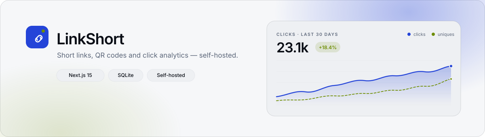
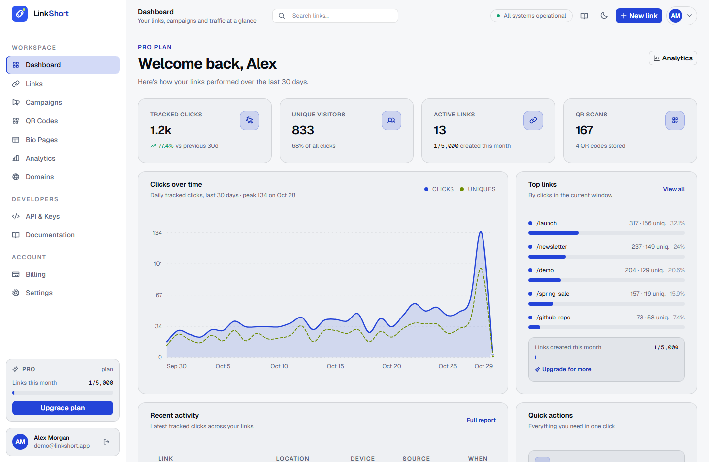
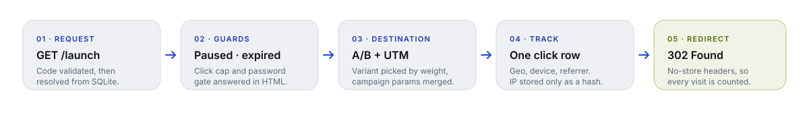
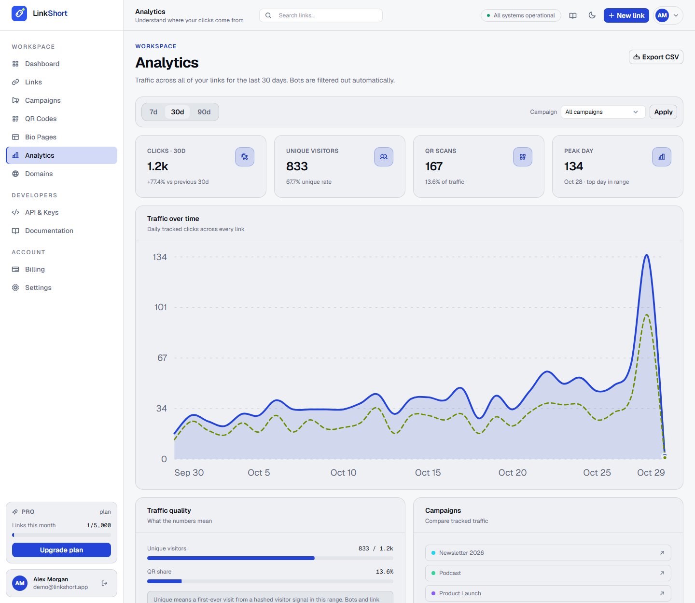
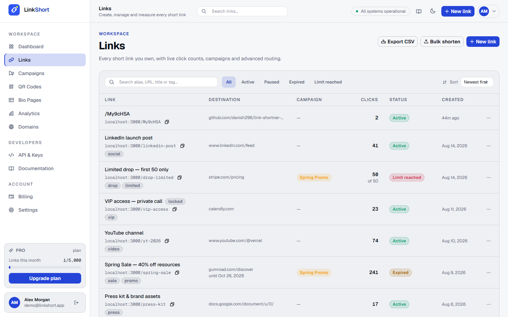
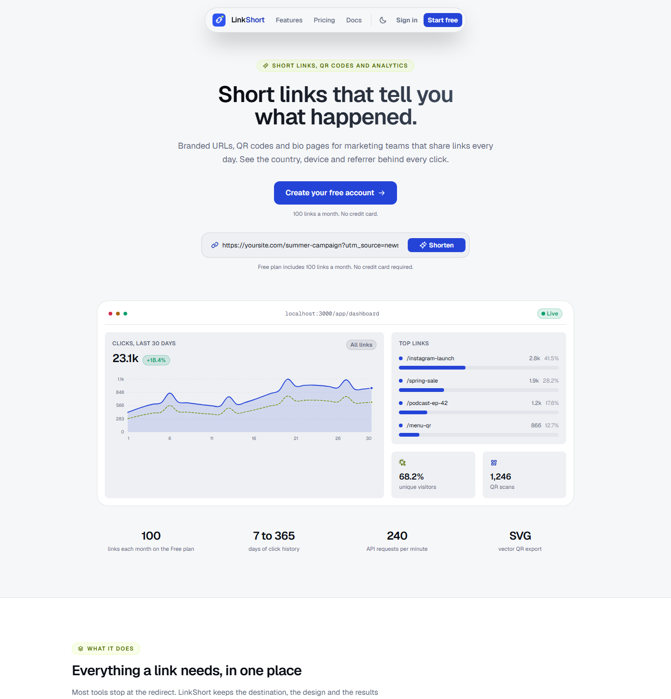

<p align="center">
  <picture>
    <source media="(prefers-color-scheme: dark)" srcset="docs/banner-dark.svg">
    <source media="(prefers-color-scheme: light)" srcset="docs/banner-light.svg">
    
  </picture>
</p>

<p align="center">
  <strong>Short links that tell you what happened.</strong><br>
  Branded URLs, trackable QR codes, campaigns and bio pages in one workspace.<br>
  One Next.js app, one SQLite file, no external services.
</p>

<p align="center">
  
  
  
  
  
  
</p>

<p align="center">
  <a href="#quickstart">Quickstart</a> ·
  <a href="#how-its-built">How it's built</a> ·
  <a href="#features">Features</a> ·
  <a href="#rest-api">REST API</a> ·
  <a href="#deployment">Deployment</a> ·
  <a href="#known-limits">Limits</a>
</p>

<p align="center">
  <picture>
    <source media="(prefers-color-scheme: dark)" srcset="docs/screenshot-dashboard-dark.png">
    <source media="(prefers-color-scheme: light)" srcset="docs/screenshot-dashboard-light.png">
    
  </picture>
</p>

## Overview

LinkShort is a complete link-management product, not a demo shell. Create a short link, decide how it behaves (expiry, click cap, password, UTM, A/B split), then read the traffic it produced: country, city, device, browser, OS and referrer. Every click is a row in SQLite, so nothing depends on a third-party analytics service.

| | |
| --- | --- |
| **Runtime** | Node.js 22.5+ (24 recommended) · `node:sqlite` built in · next 15 App Router |
| **Ships with** | Dashboard, link CRUD, analytics, QR studio, campaigns, bio pages, custom domains, plans, public API |
| **Looks like** | Midnight and light themes from one token set, following the OS preference by default |
| **Storage** | `data/linkshort.db` — one file, WAL mode, foreign keys on |
| **Needs** | No database server, no worker, no Docker, no API keys, no credit card |

<details>
<summary><b>Contents</b></summary>

- [Overview](#overview)
- [Quickstart](#quickstart)
- [How it's built](#how-its-built)
  - [Architecture](#architecture)
  - [The HTML layer](#the-html-layer)
  - [The CSS layer](#the-css-layer)
  - [The JavaScript layer](#the-javascript-layer)
  - [The data layer](#the-data-layer)
  - [The build and ship step](#the-build-and-ship-step)
- [Features](#features)
- [Plans](#plans)
- [REST API](#rest-api)
- [Routes](#routes)
- [Data model](#data-model)
- [Design system](#design-system)
- [Project structure](#project-structure)
- [Deployment](#deployment)
- [Known limits](#known-limits)
- [License](#license)

</details>

---

## Quickstart

```bash
git clone https://github.com/danish296/link-shortner-super.git
cd link-shortner-super
npm install
npm run dev
```

Open <http://localhost:3000>. The first request creates and seeds `data/linkshort.db` with a demo workspace — 13 links, four campaigns, four QR codes, a bio page, a verified domain and ~30 days of click history — so every screen has data on arrival.

> [!TIP]
> Sign in with **demo@linkshort.app** / **demo1234**. Delete the `data/` folder to reseed from scratch.

| Command | What it does |
| --- | --- |
| `npm run dev` | Development server with hot reload on port 3000 |
| `npm run build` | Production build into `.next/` |
| `npm run start` | Serve the production build |
| `npm run typecheck` | `tsc --noEmit` across the project |
| `npm run lint` | Next.js lint pass |

### Configuration

Every variable is optional locally. Copy [`.env.example`](.env.example) to `.env.local` to override.

| Variable | Default | Purpose |
| --- | --- | --- |
| `APP_SECRET` | dev placeholder | HMAC key for session cookies, IP hashes and unlock cookies. **Set this in production** — changing it invalidates sessions. |
| `APP_URL` | request origin | Public base URL for short links, QR payloads and email links. Set it behind a proxy. |
| `DATABASE_PATH` | `data/linkshort.db` | Absolute path to the SQLite file. |
| `COOKIE_SECURE` | unset | `1` marks the session cookie `Secure`. Required behind HTTPS. |

```bash
node -e "console.log(require('crypto').randomBytes(32).toString('hex'))"
```

> [!IMPORTANT]
> `APP_SECRET` also salts the truncated IP hash used for unique visitors and the click signature on password unlocks. Rotating it is safe for click data but signs everyone out.

---

## How it's built

The app is one Next.js project with three rendering surfaces that share a single data layer:

1. **React Server Components** render the marketing site, the authenticated dashboard and every product screen as HTML.
2. **A route handler** (`app/[code]/route.ts`) resolves short codes and answers with a redirect or a self-contained HTML page.
3. **Client islands** — 23 `"use client"` components — handle forms, the theme toggle, modals and scroll reveals. Everything else stays server-side.

### Architecture

```text
                    ┌─────────────────────────────────────────────┐
  GET /launch  ───▶ │ app/[code]/route.ts                         │
                    │  validate code → read links row             │
                    │  guards: paused · expired · cap · password  │
                    │  pick A/B variant → merge UTM               │
                    │  click_count++  (conditional UPDATE)        │
                    │  INSERT clicks  (geo · device · IP hash)    │
                    └───────────────┬─────────────────────────────┘
                                    │
              ┌─────────────────────┴─────────────────────┐
              ▼                                           ▼
     302 + cache-control: no-store           HTML interstitial (pixels)
```

<p align="center">
  <picture>
    <source media="(prefers-color-scheme: dark)" srcset="docs/flow-dark.svg">
    <source media="(prefers-color-scheme: light)" srcset="docs/flow-light.svg">
    
  </picture>
</p>

### The HTML layer

- **Semantic, server-rendered markup.** Pages are `<main>`/`<nav>`/`<section>` with one `<h1>`, labelled icon buttons and a skip link — no client-side shell, so first paint already contains the data.
- **Redirects never return bare JSON.** `lib/html.ts` renders the password form, expiry page, click-limit page and 404 as styled HTML with `cache-control: no-store` and `referrer-policy: no-referrer`. Those pages carry their own inlined CSS and follow `prefers-color-scheme`, independent of the app's stored theme.
- **Pixels get an interstitial.** Links with retargeting pixels return a `200` page that fires the pixel and then navigates, instead of a `302` that would drop it.
- **Accessibility is in the base layer:** visible `:focus-visible` outlines on every control, `aria-label`s on icon-only buttons, `aria-current` on navigation, and `prefers-reduced-motion` disabling reveal animations.

### The CSS layer

Tailwind CSS v4 is imported with `@import "tailwindcss"` and extended through `@theme inline`, so every utility reads a CSS custom property. Adding a theme means writing a second block of variables — no component knows which theme is active.

```css
:root {
  --bg: #050608;   --panel: #0b0d10;  --card: #16181c;  --card2: #202328;
  --ink: #eef0f4;  --muted: #9aa1ae;  --line: rgba(170, 176, 189, 0.14);
  --brand: #2f55f0; --brand-ink: #8fa6ff;
  --accent: #c9f94e; --accent-fg: #c9f94e;
  color-scheme: dark;
}

[data-theme="light"] {
  --bg: #f6f7f9;   --panel: #ffffff;  --card: #eef0f3;  --card2: #e2e5ea;
  --ink: #0a0e16;  --muted: #5b6679;  --line: rgba(18, 22, 31, 0.12);
  --brand: #2444d8; --brand-ink: #1b36b8;
  --accent: #c9f94e; --accent-fg: #4f6b00; --chart-2: #6d8c00;
  color-scheme: light;
}

@theme inline {
  --color-bg: var(--bg);
  --color-card: var(--card);
  --color-brand: var(--brand);
  --color-chart-2: var(--chart-2);
}
```

- **Gray card surfaces, in both themes.** `--card` is neutral: `#16181c` on midnight, `#eef0f3` on light. Cards never borrow the brand hue, so cobalt stays reserved for actions and lime for emphasis.
- **Derived tints.** Badges, hover washes and chart gradients are `color-mix()` expressions over tokens, not new hex values.
- **Two brand tokens.** `--brand` is the fill (buttons), `--brand-ink` is the readable text colour; `--accent` is the lime fill, `--accent-fg` the legible lime text. Light mode darkens `--chart-2` to `#6d8c00` so the uniques series stays visible on gray.
- **Motion.** One easing token (`--ease-base`) and short transitions; `.reveal` elements fade up from an `IntersectionObserver`, `.tagline-word` lights up on scroll, and both collapse under `prefers-reduced-motion`.

### The JavaScript layer

```js
// Inlined in <head> by app/layout.tsx, before the first paint.
const stored = localStorage.getItem("ls-theme");
const systemLight = matchMedia("(prefers-color-scheme: light)").matches;
document.documentElement.dataset.theme =
  stored === "light" || stored === "dark" ? stored : systemLight ? "light" : "dark";
```

- **No flash, no flash of the wrong theme.** The boot script resolves the theme synchronously, `<html>` ships with `data-theme` and `suppressHydrationWarning`, and a `matchMedia` listener keeps the page in sync until the visitor picks a side in the toggle. The choice is stored under `ls-theme`; clearing it returns the app to the OS preference.
- **Islands, not a SPA.** Forms validate in the browser, `fetch()` JSON to `/api/*`, then call `router.refresh()` so the Server Component re-renders with fresh data.
- **Charts are SVG rendered on the server.** `components/charts.tsx` builds smooth cubic paths, grid lines, donuts and bar lists — no charting dependency and no hydration cost.
- **Node built-ins over packages:** `node:crypto` for HMAC-SHA256 sessions and scrypt password hashing, `node:sqlite` for storage, `qrcode` for QR SVG generation, `@phosphor-icons/react` for the icon set (re-exported through `components/icons.tsx`).

### The data layer

SQLite runs in-process with `journal_mode = WAL`, `foreign_keys = ON` and `busy_timeout = 5000`. Two details carry the product's correctness:

```sql
-- Capacity is enforced by the write itself, so parallel clicks cannot overshoot.
UPDATE links SET click_count = click_count + 1
WHERE id = ? AND (max_clicks IS NULL OR click_count < max_clicks);
-- changes === 0 → the link is closed, render the limit page.
```

- **Unique visitors** are first-seen-per-link, computed from a truncated HMAC of the client IP. Raw addresses are never stored.
- **Bot traffic** is flagged at insert time from the user agent and excluded from unique counts.
- **QR scans** are attributed when the redirect carries `?qr=<id>` (generated QR payloads do) and increment the code's scan counter.
- The click row is written *before* the response, so the dashboard is consistent the moment a visit lands.

### The build and ship step

`next build` is the whole pipeline: TypeScript, Tailwind and the React compiler run inside it, and fonts are fetched once at build time by `next/font` and served from the app's own origin. There is no separate bundler config.

```bash
npm ci
npm run typecheck
npm run build
APP_SECRET=… APP_URL=https://sho.rt COOKIE_SECURE=1 npm run start
```

The production output is a normal Next.js server; `next.config.ts` pins `outputFileTracingRoot` so the build does not infer a workspace root from a lockfile higher up the tree.

---

## Features

| Area | What you actually get |
| --- | --- |
| **Short links** | Custom aliases, expiry dates, click caps, password protection, pause/resume, UTM parameters, A/B variants with weights, tags, retargeting pixels, bulk actions. |
| **Click analytics** | 7 / 30 / 90 / 365-day windows, clicks vs unique visitors, country, city, device, browser, OS, referrer, UTM breakdowns, bot filtering, CSV export of raw rows. |
| **QR codes** | Foreground/background colours, quiet-zone margin, error-correction level, centre label, per-code scan attribution, SVG download. |
| **Campaigns** | Colour-coded groups of links with comparative traffic, used to filter analytics. |
| **Bio pages** | Public pages at `/p/[slug]` with social, heading, text and link blocks; each tap is logged as a click with its block id. |
| **Custom domains** | Add a branded host, get a DNS TXT verification token, see verification state. |
| **Plans and billing** | Free / Basic / Pro / Growth quotas enforced in the API layer, invoice history, auto-renew toggle. |
| **Public REST API** | Bearer-key endpoints under `/api/v1`, 240 link creations per minute per user. |
| **Presentation** | Server-rendered SVG charts, two themes that follow the OS, keyboard-accessible controls, reduced-motion support, OG image and favicon. |

<details>
<summary><b>More screens</b></summary>

**Analytics — one view for the whole workspace**

<p align="center">
  
</p>

**Links — filters, caps, campaigns and status in one table**

<p align="center">
  
</p>

**Landing page — a working shortener above the fold**

<p align="center">
  
</p>

</details>

## Plans

Quotas are enforced when links, QR codes, campaigns, bio pages and domains are created. The plan's window caps the analytics ranges offered in the dashboard.

| Plan | Price | Links / month | QR codes | Campaigns | Bio pages | Domains | Analytics window |
| --- | --- | --- | --- | --- | --- | --- | --- |
| Free | $0 | 100 | 5 | 3 | 1 | 0 | 7 days |
| Basic | $5 | 1,000 | 50 | 20 | 5 | 1 | 30 days |
| Pro | $13 | 5,000 | 100 | 50 | 15 | 3 | 90 days |
| Growth | $41 | 15,000 | 250 | 150 | 30 | 10 | 365 days |

Exceeding a quota returns HTTP `402` with a message naming the limit and the plan.

## REST API

The public API authenticates with the account API key (visible and rotatable on `/app/api`), not the session cookie.

```bash
curl -X POST http://localhost:3000/api/v1/shorten \
  -H "Authorization: Bearer $LINKSORT_KEY" \
  -H "Content-Type: application/json" \
  -d '{
        "url": "https://example.com/launch",
        "alias": "launch",
        "title": "Launch",
        "tags": ["launch"],
        "expiresAt": "2026-12-31",
        "utmCampaign": "winter"
      }'
```

| Method | Path | Purpose |
| --- | --- | --- |
| `POST` | `/api/v1/shorten` | Create a link. Accepts `url`, `alias`, `title`, `campaignId`, `tags`, `password`, `expiresAt` (ISO date or epoch ms), `maxClicks`, `utm*`, `variantB`, `abWeight`. |
| `GET` | `/api/v1/links` | List links with `q`, `status`, `sort`, `page`, `size`. |
| `POST` | `/api/v1/links` | Create a link — same body as `/shorten`. |
| `GET` | `/api/v1/links/[code]` | Fetch one link by code. |

```json
{
  "id": "0d1c…",
  "code": "launch",
  "shortUrl": "http://localhost:3000/launch",
  "url": "https://example.com/launch",
  "title": "Launch",
  "tags": ["launch"],
  "clicks": 0,
  "isActive": true,
  "expiresAt": 1798675200000
}
```

**Errors** are always JSON in the shape `{ "error": "message" }` with a matching status:

| Status | When |
| --- | --- |
| `400` | Validation failed — bad URL, malformed alias, invalid date |
| `401` | Missing or wrong bearer key |
| `402` | Plan quota reached |
| `404` | Link, QR code or campaign not found |
| `409` | Alias or campaign name already taken |
| `429` | More than 240 creations in a minute |

`POST /api/v1/shorten` and `GET /api/v1/links/[code]` return the link object directly. The session API used by the dashboard wraps its responses (`{ "ok": true, "link": { … } }`).

<details>
<summary><b>Session API used by the dashboard</b></summary>

Endpoints live under `/api/*` — links, campaigns, domains, QR codes, pages, billing, account and export — and reject cross-origin requests. Two are worth calling out:

- `GET /api/export/clicks?days=30` — streams every click row as CSV.
- `GET /api/qrcodes/[id]/image` — renders the QR code as SVG; add `?download=1` to send it as an attachment.

</details>

## Routes

<details>
<summary><b>Public routes</b></summary>

| Path | What it is |
| --- | --- |
| `/` | Marketing landing with a working shortener |
| `/pricing`, `/docs` | Plan comparison, API and link-behaviour documentation |
| `/terms`, `/privacy`, `/cookies` | Legal pages |
| `/login`, `/register`, `/forgot-password`, `/reset-password`, `/verify-email` | Auth flows |
| `/<code>` | Short-link redirect, password form or styled error page |
| `/p/[slug]` | Public bio page |

</details>

<details>
<summary><b>App routes (session required)</b></summary>

`/app/dashboard` · `/app/links` · `/app/links/[id]` · `/app/analytics` · `/app/campaigns` · `/app/qrcodes` · `/app/domains` · `/app/pages` · `/app/pages/[id]` · `/app/billing` · `/app/api` · `/app/settings`

</details>

## Data model

Eleven tables are created on first boot in `lib/db.ts`.

| Table | Holds |
| --- | --- |
| `users` | Account, plan, API key, password hash, plan date |
| `sessions` | Session tokens with expiry |
| `links` | Short codes, destination, UTM, A/B variant, password hash, caps, counters |
| `clicks` | One row per click: geo, device, browser, referrer, UTM, bot and unique flags |
| `campaigns` | Named, colour-coded groups of links |
| `qrcodes` | Design settings, scans, foreground/background colours |
| `pages`, `page_blocks` | Bio pages and their ordered blocks |
| `domains` | Custom domains and verification tokens |
| `invoices` | Plan changes recorded as paid invoices |
| `unlock_attempts` | Throttling for password-protected links |

> [!NOTE]
> Deleting `data/linkshort.db` resets everything and reseeds on the next request.

## Design system

All colour lives in `app/globals.css` as CSS custom properties, mapped into Tailwind through `@theme inline`, so one declaration serves both themes.

| Token | Dark | Light | Job |
| --- | --- | --- | --- |
| `--bg` | `#050608` | `#f6f7f9` | Page background |
| `--panel` | `#0b0d10` | `#ffffff` | Shell, sidebar, page panel |
| `--card` | `#16181c` | `#eef0f3` | Card surface — neutral gray in both themes |
| `--card2` | `#202328` | `#e2e5ea` | Nested surfaces and rails |
| `--line` | `rgba(170,176,189,.14)` | `rgba(18,22,31,.12)` | Hairlines and borders |
| `--ink` / `--muted` | `#eef0f4` / `#9aa1ae` | `#0a0e16` / `#5b6679` | Primary and secondary text |
| `--brand` | `#2f55f0` | `#2444d8` | Fills, primary buttons |
| `--brand-ink` | `#8fa6ff` | `#1b36b8` | Brand-coloured text and icons |
| `--accent` | `#c9f94e` | `#c9f94e` | Lime highlight fill |
| `--accent-fg` | `#c9f94e` | `#4f6b00` | Readable lime text |
| `--chart-2` | `#c9f94e` | `#6d8c00` | Unique-visitors series |
| `--ok` | `#3ddc97` | `#0e9f6e` | Success and positive deltas |
| `--warn` | `#ffc53d` | `#a86300` | Warnings, limited links |
| `--bad` | `#ff6b81` | `#cf2f4d` | Errors, expired links |

- Charts use `--chart-1…6`. Bar lists encode magnitude with a single colour; only the donut uses categorical colours.
- Everything interactive is cobalt. Lime is emphasis — badges, the uniques series, the logo dot — never a button fill.
- Cards, popovers and nested panels use gray steps so the brand hue never tints a large surface.
- Adding a theme means declaring one block of variables; no component is theme-aware.

## Project structure

```text
app/
  (marketing)/      landing, pricing, docs, legal pages
  (auth)/           login, register, password reset, verification
  app/              authenticated product screens
  api/              session API, auth, export, public v1 API
  [code]/           short-link resolver
  p/[slug]/         public bio page
components/
  charts.tsx        server-rendered SVG area chart, sparkline, donut, bar list
  marketing/        header, footer, hero shortener, pricing grid
  links/ qrcodes/   feature views and forms
  ...               app shell, theme toggle, icons, modals, reveals
lib/
  db.ts             schema, migrations and SQLite connection
  links.ts          link model, validation, A/B and UTM logic
  track.ts          click logging, IP hashing, QR attribution
  auth.ts           sessions, scrypt hashes, signed cookies
  plans.ts quota.ts plan definitions and quota enforcement
  html.ts           server-rendered redirect, password and error pages
docs/               README artwork and screenshots
data/               SQLite database (git-ignored)
```

## Deployment

```bash
npm ci
npm run build
APP_SECRET=... APP_URL=https://sho.rt COOKIE_SECURE=1 npm run start
```

> [!WARNING]
> Run **one instance, or mount a shared volume**. SQLite and the in-process rate limiter both assume a single writer; horizontal scaling needs a networked database and a shared rate-limit store.

- Put the app behind HTTPS and set `COOKIE_SECURE=1`. Session and unlock cookies are HTTP-only and `SameSite=Lax`.
- Back up by copying `data/linkshort.db` — plus `-wal` and `-shm` while the process is running.
- Set `APP_URL` when a proxy or CDN sits in front; short links and QR payloads are generated from it.
- The `data/` directory and `.env*` files are git-ignored; only `.env.example` is committed.

## Known limits

This is a working product backed by a real database, not a mockup. These are the seams to close before charging money for it:

| Area | Current behaviour | To productionise |
| --- | --- | --- |
| Payments | Checkout writes a paid invoice; no card is charged | Swap in a processor in `app/api/billing/*` |
| Email | Verification and reset links are printed to the server log | Add a mail provider in `app/api/auth/*` |
| Rate limiting | Buckets live in a module-level map, reset on restart | Move to Redis or the database |
| API keys | Stored in plaintext, shown in the UI | Hash them and show once |
| Monthly click caps | Advertised in plan copy, not enforced | Add a counter check before logging |
| Bot detection | User-agent heuristics | Good enough for reporting, not for anti-fraud |

## License

MIT — use it, fork it, self-host it.

<p align="center"><sub>Built with Next.js, SQLite and a lot of CSS custom properties. Maintained by <a href="https://github.com/danish296">@danish296</a>.</sub></p>
